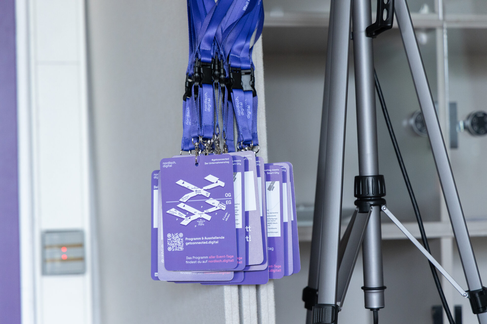
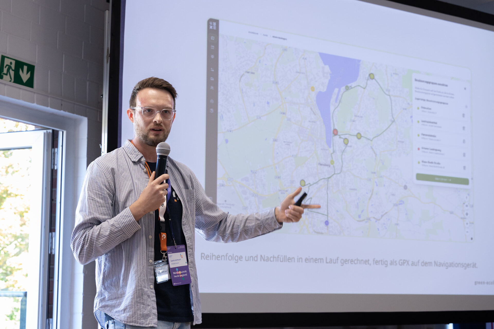
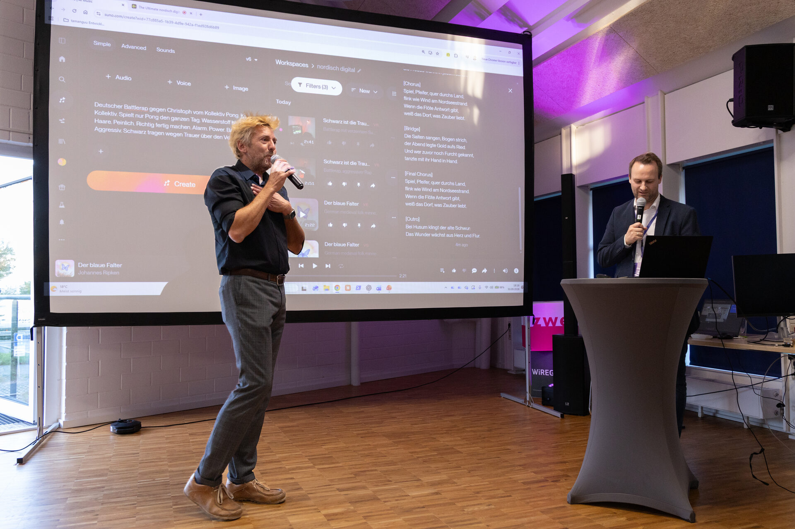
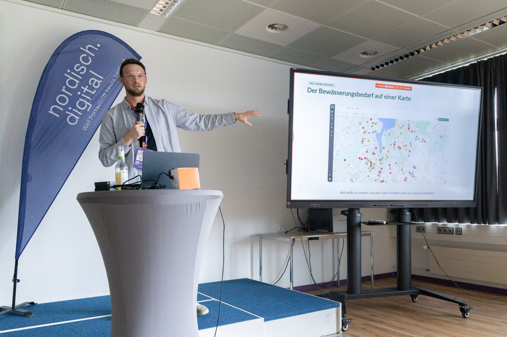
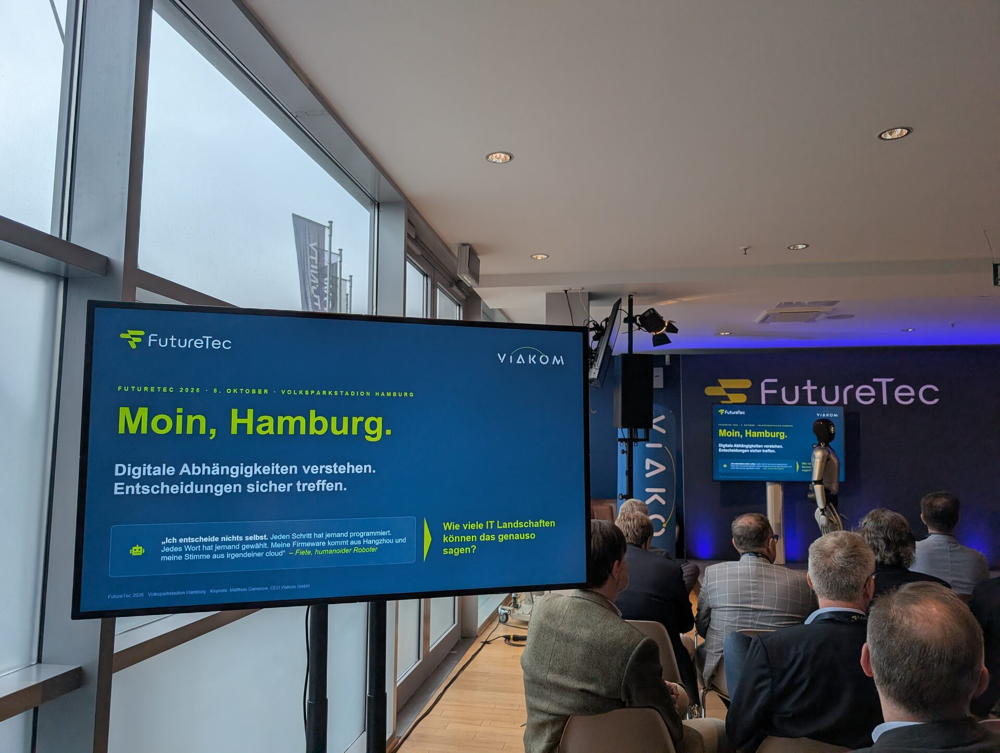

Between 30 September and 8 October we spent three days talking about Green Ecolution. In Flensburg I presented the project twice at nordisch.digital, once in three minutes on stage and once at the TechSnack at the university. At FutureTec in Hamburg it was the conversations that counted.

## nordisch.digital in Flensburg

[nordisch.digital](https://nordisch.digital) is the networking event for digitalization in and around Flensburg. It is run by a wide circle of partners, including lisezwei, the Flensburg University of Applied Sciences and the Smarte Grenzregion. The first day took place on 30 September at lisezwei, and on 1 October it continued at the university. For us it was a home game, since the university and the Smarte Grenzregion have been part of Green Ecolution from the start.

## Three minutes at lisezwei

At lisezwei there was a new format called 3 Minutes to Match. Anyone presenting had three minutes. The audience was a mix of companies, students, teachers and other interested people, each looking at a project like ours from a different angle.

Three minutes are not enough for architecture and measurement series, but they are enough for the basic idea. Many cities water their trees based on experience, without knowing which tree actually needs water right now. Green Ecolution measures soil moisture with sensors, shows the condition of the trees on a map and plans the route for the next watering run from it. In Flensburg the [first sensors](/blog/erste-sensoren-im-boden) have been in the ground since May.

Besides the pitches, there was also an AI music battle at lisezwei.

## TechSnack at the university

On the second day nordisch.digital moved to the Flensburg University of Applied Sciences, where Green Ecolution began. At the TechSnack, under the title "From research project to practice" I told the whole story, from the idea through the research project to its continuation in industry.

The idea came from the Smarte Grenzregion. City trees should be watered when they need it, not on a fixed schedule. In 2024 nine students in the Applied Computer Science master's programme turned that into a research project. They built their own sensor, which measures soil moisture and soil water tension at three depths and transmits over LoRaWAN, and a platform that shows the irrigation demand on a map and calculates the route for the watering run. The project ended in April 2025. The software worked and was open source, the only open question was what would come next.

The answer came in autumn 2025 with the state's [Open Innovation programme](/blog/offene-innovation). Together with the City of Flensburg and the Smarte Grenzregion, PROGEEK presented the concept to the jury, and Green Ecolution became one of 17 projects out of 61 submissions to receive funding. Since then the city has been the lead partner, PROGEEK develops and operates the platform, and the TBZ uses it in day-to-day operations.

A lot changed on the way into practice. Instead of the custom-built research sensor, a production model with our own firmware is now in the ground. It measures at only two depths, but it is affordable for an entire city. The installations brought new questions. At two sites no LoRaWAN signal came through, and [the same reading means something different depending on the soil](/blog/acht-von-zehn-sensoren). To determine the soil type we use a test from the kitchen. Soil goes into a jar with water and gets shaken. After a few hours sand, silt and clay have settled in layers, and their thickness gives the proportions. The application then derives the soil type according to the German soil mapping guidelines.

## Conversations at FutureTec

On 8 October we were at FutureTec at Hamburg's Volksparkstadion, a fair about digitalization, cloud, IT security and AI. We had many conversations there, about Green Ecolution and about the topics the fair was built around.

Green Ecolution is open source. All of the code is on GitHub, and any municipality can take the platform and adapt it to its own workflows. That means we have nothing to hold back in conversations like these. If someone wants to know how we process the sensor data or how route planning works, they get an honest answer and, if they like, the link to the code.

## Thank you

Thanks to all partners of nordisch.digital for organizing the event and for the slot in the new format, and to everyone who talked to us over those three days. If you want to try Green Ecolution yourself, the demo is at [demo.green-ecolution.de](https://demo.green-ecolution.de) and the source code is on [GitHub](https://github.com/green-ecolution). For questions and ideas you can reach us through the [contact page](/contact).
