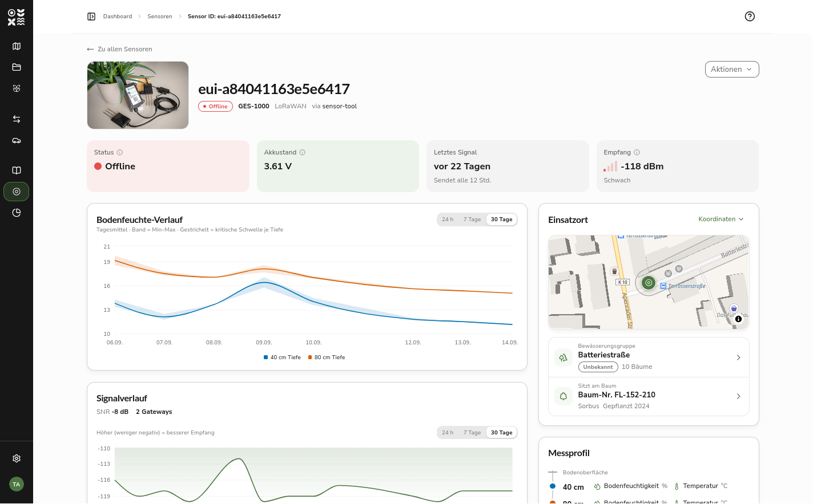
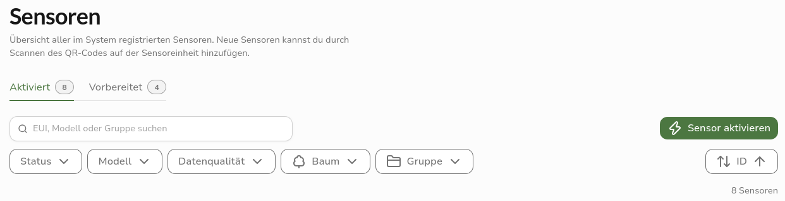
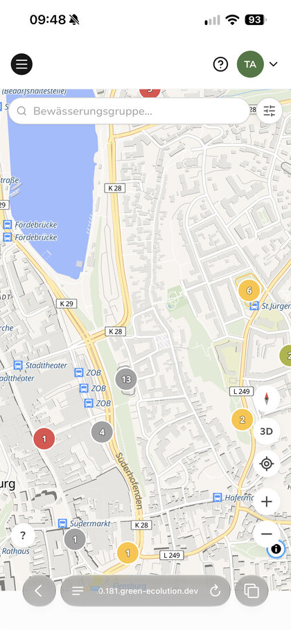

Version 0.8.0 widmet sich vor allem der Arbeit mit Sensoren und der Nutzung unterwegs. Die Detailseite eines Sensors ist neu aufgebaut, und die Sensorliste trennt Geräte, die noch auf ihren Einbau warten, von denen im Einsatz. Auf dem Smartphone bekommt die Karte deutlich mehr Platz. Plugins erhalten Zugriff auf Kamera und Bluetooth sowie einen festen Platz in der Navigation, und ihre Ansicht kann jetzt auch von einem Dienst kommen, der nur intern läuft. Daneben ist das Backend für große Datenbestände beschleunigt worden.

## Highlight des Releases

### Die Detailseite eines Sensors

Die Detailseite eines Sensors folgt jetzt dem Aufbau des Dashboards einer Bewässerungsgruppe. Der Kopf zeigt ein Foto des Sensormodells, die ID mit dem Verbindungszustand sowie Modell und Sensortyp. Darunter fassen vier Kennzahlen den Zustand zusammen: Status, Akkustand, Letztes Signal und bei LoRaWAN-Sensoren der Empfang, eingeordnet in Gut, Ausreichend oder Schwach.

Auf breiten Bildschirmen teilt sich die Seite in zwei Spalten. Links stehen die Verläufe, rechts, wo der Sensor sitzt und was er misst. Der neue Abschnitt Einsatzort zeigt den Sensor auf einer kleinen Karte zwischen den umliegenden Bäumen, darunter die Bewässerungsgruppe mit ihrem Zustand und der Zahl ihrer Bäume und schließlich den Baum, an dem der Sensor steckt. Beide Zeilen führen per Klick auf die jeweilige Detailseite. Das Messprofil zeigt als schmalen Tiefenschnitt, in welcher Tiefe der Sensor was erfasst. Seine Punkte tragen dieselbe Farbe wie die Kurve der jeweiligen Tiefe im Messverlauf, so lassen sich Profil und Diagramm einander zuordnen.

Auf Tablet und Smartphone folgen die Abschnitte untereinander, der Einsatzort direkt nach dem Messverlauf. Die kleine Karte verschiebt sich dort nicht mehr, wenn man über die Seite wischt.

Der Hinweis zur Datenqualität nimmt nur noch eine Zeile ein, solange keine Auffälligkeit offen ist. Liegen unplausible Messwerte vor, lässt sich die Liste der betroffenen Werte aufklappen. Sie zeigt zunächst die fünf jüngsten, über Alle … anzeigen die vollständige Liste. Der Signalverlauf erscheint nur noch, wenn es Messwerte gibt, und bietet keinen Zeitraum über die gesamte Laufzeit mehr an, der Tausende einzelner Punkte geladen und gezeichnet hatte.

## Neue Funktionen

### Vorbereitete Sensoren in einem eigenen Reiter

Die Sensorliste teilt die Geräte auf zwei Reiter auf. Aktiviert ist beim Öffnen ausgewählt und zeigt die Sensoren, die bereits im Einsatz sind, ob online oder offline. Vorbereitet sammelt die Geräte, die zwar angelegt, aber noch nicht aktiviert sind. Neben jedem Reiter steht die Zahl seiner Sensoren, sodass auch ohne Wechsel erkennbar ist, ob noch Geräte auf ihren Einbau warten.

Im Reiter Vorbereitet bleiben nur Suche, Modellfilter und Sortierung, denn ein noch nicht aktiviertes Gerät hat weder Messwerte noch einen verknüpften Baum. Der Suchbegriff bleibt beim Wechsel zwischen den Reitern erhalten. Bestehende Links, die nach dem Status Vorbereitet filtern, führen direkt in den neuen Reiter.

### Mehr Platz für die Karte auf dem Smartphone

Auf schmalen Bildschirmen liegen Suche und Filter jetzt über der Karte, statt ihr Platz wegzunehmen, und die Karte füllt den verbleibenden Raum vollständig aus. In Safari unter iOS reicht sie bis hinter die schwebende Adressleiste, die Bedienelemente am unteren Rand rücken darüber. Als installierte App nutzt Green Ecolution die volle Bildschirmfläche und lässt dabei die Bereiche frei, die das Gerät selbst belegt, etwa für die Kamera oder die Gestenleiste.

Unter Android und in der installierten App ließ sich die Kartenseite außerdem ein Stück scrollen, weil sie höher war als der sichtbare Bereich. Sie ist jetzt auf die tatsächliche Bildschirmhöhe begrenzt.

### Plugins mit Gerätezugriff

Plugins mit eigener Ansicht erscheinen jetzt im Abschnitt Plugins der Seitennavigation, und zwar für alle, die sie öffnen dürfen. Rechte zur Verwaltung von Plugins sind dafür nicht nötig. Bisher war eine Plugin-Ansicht nur über ihre Adresse erreichbar, die nach der Installation an die betroffenen Personen weitergegeben werden musste. Ist für eine Ansicht kein Zugriffsrecht festgelegt, genügt ein beliebiges Recht in der Organisation des Plugins oder darüber. Personen aus anderen Organisationen sehen sie nicht.

Bei der Installation und später auf der Detailseite eines Plugins lässt sich seiner Ansicht der Zugriff auf Kamera und Bluetooth freigeben. Die Freigabe ersetzt nicht die Rückfrage des Browsers: Die Ansicht kann diese Funktionen erst nutzen, wenn die Person dort zustimmt.

Bei jedem Öffnen erhält die Ansicht ein einmalig gültiges Ansichtsticket. Darüber kann das Backend des Plugins erfahren, wer die Ansicht geöffnet hat, nämlich Kennung und Namen der Person, ohne Zugriff auf deren Anmeldedaten zu bekommen. Über die Import-Schnittstelle können Plugins außerdem vorbereitete Sensoren anlegen und nicht mehr nur Bäume.

### Plugin-Ansichten aus dem internen Netz

Bisher musste die Ansicht eines Plugins unter einer öffentlich erreichbaren Adresse liegen. Der im Ausblick von [0.7.0](/de/releases/v0.7.0) angekündigte dritte Modus ist jetzt auswählbar: Bei der Installation steht neben Keine Ansicht und Extern gehostet die Option Intern (per Proxy) zur Verfügung. Dafür genügen Dienstname und Port, etwa `kataster.plugins.svc.cluster.local:8080`. Green Ecolution reicht die Ansicht dann unter einer eigenen Adresse durch, der Dienst selbst muss nicht aus dem Internet erreichbar sein.

Bei jedem Aufruf prüft Green Ecolution, ob die Person die Ansicht öffnen darf. Werden ihr die nötigen Rechte entzogen oder wird das Plugin deaktiviert, endet der Zugriff mit dem nächsten Aufruf. Kennung und Namen der Person erhält das Plugin in diesem Modus mit jeder Anfrage direkt von Green Ecolution, der Umweg über das Ansichtsticket entfällt. Die Anmeldedaten der Person gelangen auch hier nicht zum Plugin.

Welche Dienste durchgereicht werden dürfen, legt der Betrieb der Instanz in der Konfiguration fest. Ein Dienst außerhalb dieser Liste wird beim Speichern abgelehnt, und das Formular nennt den Grund. Jedes Plugin erscheint unter einer eigenen Subdomain, etwa `kataster.plugins.example.org`, die zur selben Domain gehören muss wie die Anwendung. Ist der Proxy in einer Installation nicht eingerichtet, lässt sich der Modus zwar auswählen, das Speichern scheitert dann aber mit einem entsprechenden Hinweis.

## Weitere Verbesserungen

### Schneller bei großen Datenbeständen

Für diesen Release wurde das Backend mit einem Testbestand von 500.000 Bäumen und 14,6 Millionen Messwerten vermessen. Mehrere Abfragen durchsuchten dabei ganze Tabellen, darunter die Umkreissuche, die Freitextsuche und die Verläufe der Bodenfeuchte. Neue Indizes und umgebaute Abfragen beheben das. Die Liste der Bewässerungsgruppen etwa braucht im größten Testbestand statt 831 nur noch 9 Millisekunden.

Die Umrisse der Bewässerungsgruppen auf der Karte wurden bisher bei jedem Aufruf aus allen Bäumen berechnet, was bei 500.000 Bäumen rund eine Sekunde dauerte. Sie werden jetzt gespeichert und neu berechnet, sobald sich die Bäume einer Gruppe ändern.

Auch bei kleinen Beständen antworten die Listen schneller. Die Datenbank hatte manche Abfragen vor der Ausführung erst kompiliert, was länger dauerte als die Abfrage selbst, sodass die Sensorliste schon mit zehn Sensoren über 100 Millisekunden brauchte. Diese Kompilierung ist für die Anwendung abgeschaltet.

Wer eine Instanz mit sehr vielen Bäumen betreibt, sollte beim Update einplanen, dass das Anlegen der neuen Indizes etwas Zeit braucht. Beim Testbestand waren es rund 16 Sekunden.

### Sprachwechsel aus dem Benutzermenü

Der Umschalter zwischen Deutsch und Englisch lag bisher nur am Fuß der Profilseite und wurde dort auf die volle Breite gestreckt. Er steht jetzt zusätzlich im Benutzermenü, das sich über das Namenskürzel am Fuß der Seitennavigation öffnet, und ist damit von jeder Seite aus erreichbar. Auf der Profilseite hat er einen eigenen Abschnitt bekommen.

## Behobene Fehler

### Einsatzpläne

Die Fahrzeugauswahl im Formular eines Einsatzplans bot die Option Kein Fahrzeug an, obwohl ein Einsatzplan immer ein Fahrzeug braucht und das Speichern in diesem Fall scheiterte. Die Auswahl listet jetzt nur noch vorhandene Fahrzeuge. Bleibt das Feld leer, weist das Formular darauf hin.

### Karte

Im Kartenpanel einer Bewässerungsgruppe stand bei der Bodentemperatur Keine Daten, wenn die Sensoren ihre Messwerte im neueren, allgemeinen Format übertragen. Die Temperatur wird jetzt aus beiden Formaten gelesen.

Auf dem Smartphone verdeckte die aufgeklappte Leiste am unteren Rand der Karte das geöffnete Navigationsmenü. Das Menü liegt jetzt darüber, auch während es sich schließt.

## Ausblick

Zwei der im Ausblick von [0.7.0](/de/releases/v0.7.0) genannten Punkte stehen weiterhin aus: die englische Übersetzung des Handbuchs und die Freigabe einzelner Ressourcen an Unterorganisationen.

Rückmeldungen und Fehlerberichte sind jederzeit willkommen auf [GitHub](https://github.com/green-ecolution/green-ecolution/issues).
