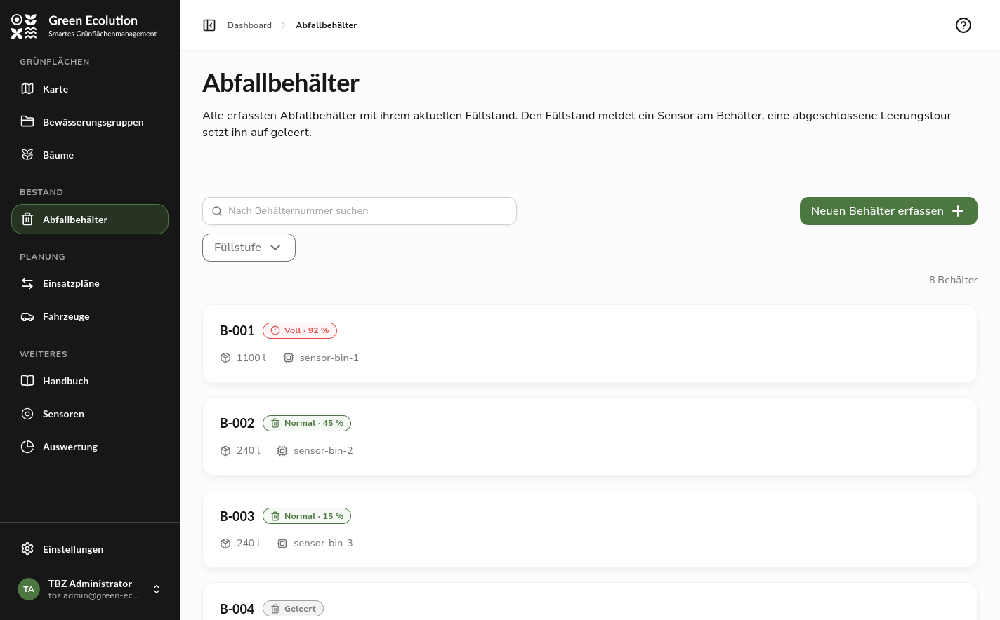
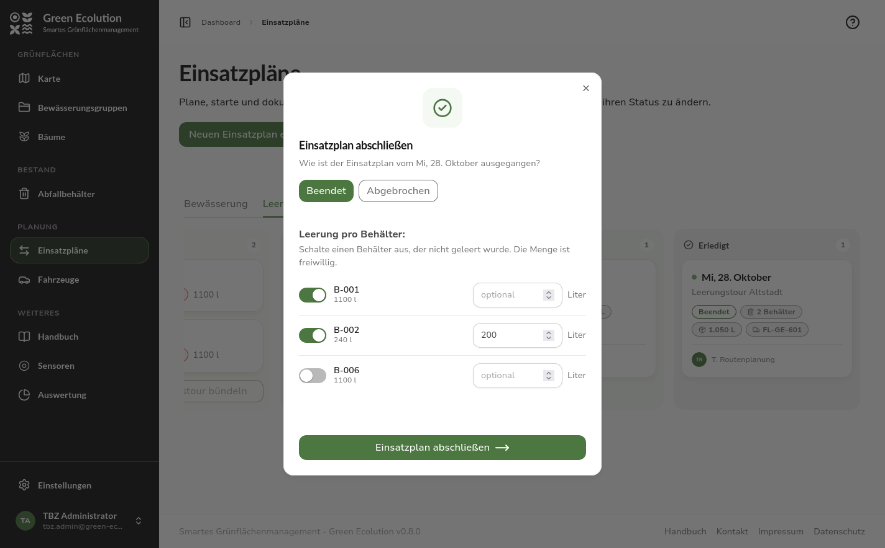
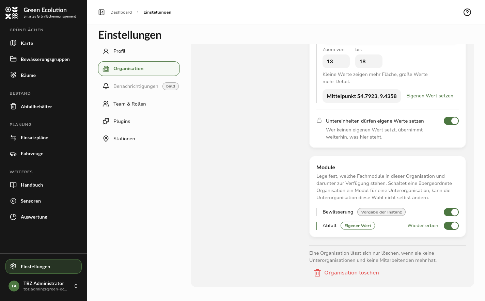
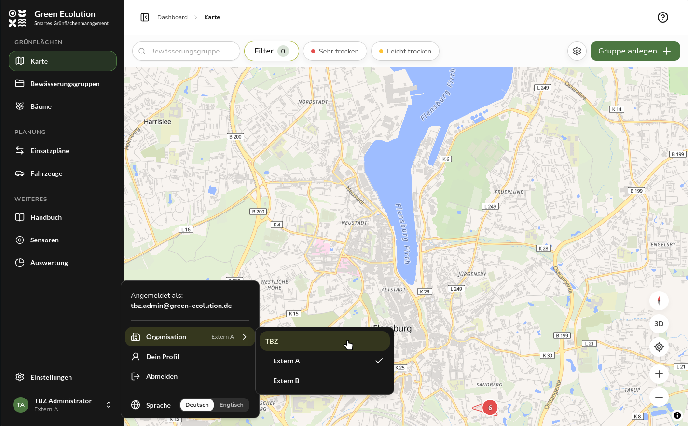
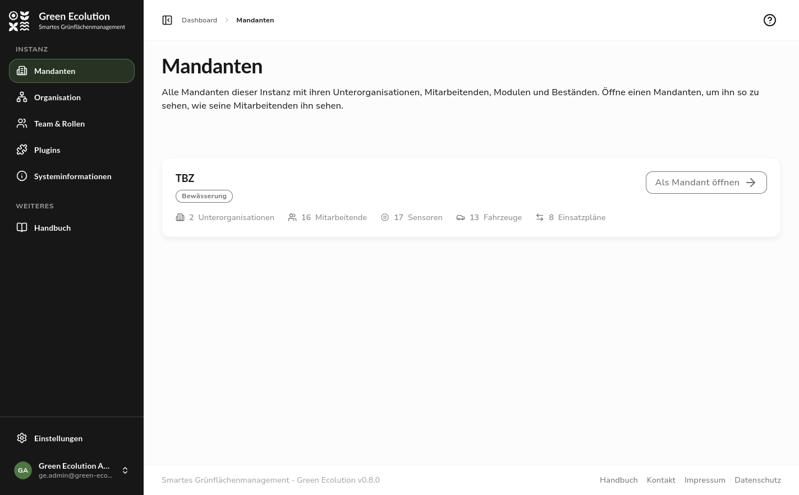
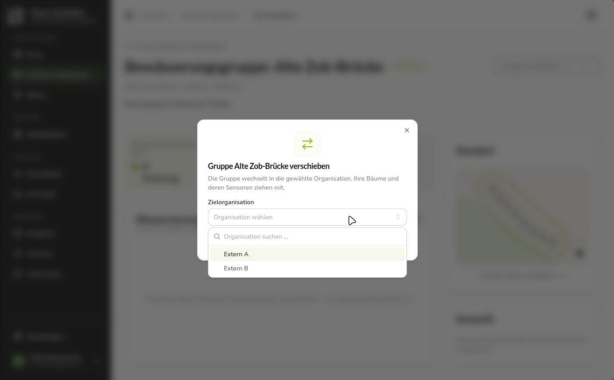
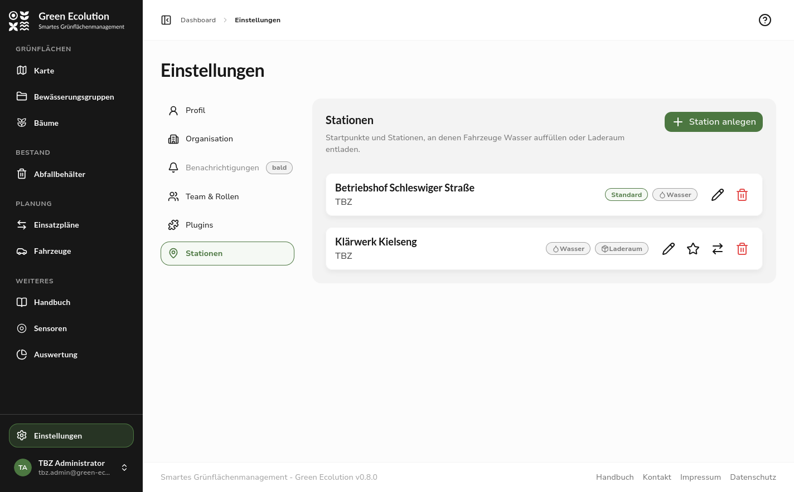

Version 0.9.0 changes how Green Ecolution is put together. The irrigation application becomes a shared core with modules that can be switched on and off per organization. Irrigation is the first of these modules, the second is new: waste bins with fill levels and collection tours. Instances with several organizations gain an organization switcher in the user menu, a tenant overview for the operator and a way to move resources from their action menus. Stations can now be managed in the settings, and the GPX file of a plan carries the stops as waypoints.

## Release Highlight

### Waste bins and collection tours

The waste module extends Green Ecolution with waste bins and their collection. It is switched off by default and is enabled per organization in the Modules section of the organization page. Only then do the Waste bins area appear under Assets in the sidebar, the bins on the map and the collection tours in the planning board.

A bin is recorded with its number, its volume in litres and its depth in centimetres, and its location is set with a click on the map. The depth is the distance from the sensor to the bottom of the bin. Together with the latest distance reading it yields the fill level: if the sensor measures 60 cm in a bin 120 cm deep, the bin is half full. From this the application derives one of four fill states. Full means the organization's threshold has been reached, Normal applies below it. A bin is Emptied after a completed collection tour, and Unknown as long as there is no reading or the latest one is older than the organization's offline limit. Each organization sets the threshold in its own settings. The default is 80 percent, and the value is inherited down the organization tree like the other operational defaults.

The list shows every bin with its number, volume, fill state and sensor and can be filtered by fill state. On the map the bins are coloured by fill state. The detail page places master data and fill level side by side, and comments can be left below, for example about a damaged lid. The fill level is reported by a distance sensor that is assigned to a bin through the sensor management, just as it was assigned to a tree before. For now the module ships a simulated ultrasonic sensor as its sensor model.

Collection tours are created on the same board as irrigation runs. When both modules are active, a switcher above the board changes between Irrigation and Collection, and the Suggestions column shows the full bins. They can be bundled into a tour or put together in the form through Select bins, where Select all full bins marks every bin at or above the threshold at once. A bin's demand is its volume times its fill level, and for an unknown fill the planning assumes the full volume. From this the application works out how much cargo space the tour needs. The vehicle therefore has to have a cargo space recorded, and there has to be a station where it can unload, because the route only ends after unloading. If either is missing, the application says so instead of computing a route.

When a tour is finished, the application asks for each bin whether it was emptied and optionally takes the collected amount in litres. Emptied bins change to the fill state Emptied until the sensor reports again. The bundled role template Waste collection holds the permissions for the daily work: managing bins and tours and viewing sensors, vehicles, regions and start points.

In this version the waste module is not yet intended for production use. For now it serves as proof that a second module with its own objects, sensors and tours can build on the shared core, and it is deliberately limited to that core workflow. The only sensor model available so far is a simulated distance sensor. Anyone switching the module on should treat it as a trial state; irrigation is not affected by this.

## New Features

### Modules per organization

From this version on, Green Ecolution consists of a shared core and modules. The core covers organizations, roles, sensors, vehicles and stations. A module brings the areas that belong to one task: the irrigation module provides trees, irrigation groups, irrigation runs and the evaluation along with their map layers and dashboard tiles, the waste module provides the bins and collection tours.

The Modules section of the organization page has one switch per module. A module that is switched on is available to the organization and every organization below it. As with the operational defaults, a badge shows where the state comes from: an own value, an inherited one or the instance default. What a parent organization sets for a sub-unit is binding for it. The switch then carries the note Set by and can only be changed again from the organization that set it. A module switched off from above no longer appears in the sub-unit's list at all.

When a module is off, its areas disappear from the navigation, the map, the dashboard and the planning board, and a link to one of its pages shows the note Module not active. The data stays untouched and is available again as soon as the module is switched back on. The handbook follows the same rule and shows signed-in people only the chapters of the modules active for them.

### Choosing an organization

Anyone who belongs to several organizations or manages an organization with sub-units finds the new entry Organization in the user menu. It opens the reachable part of the organization tree, with a search field above it from nine entries on. Once an organization is chosen, the choice applies together with its sub-units: map, lists, plans, dashboard and settings show only what belongs to that part, and the map opens at the view configured for that organization. New objects are created in the chosen organization, and your own permissions apply only within the choice, even if you hold more elsewhere in the tree.

The user card at the foot of the sidebar then shows the organization's name instead of the e-mail address. Choosing your own organization clears the choice, and the browser remembers the setting for the account. If a link leads to an object outside the chosen organization, the application reports it as not found or shows No access and in both cases offers to switch back to your own organization.

### Tenant overview

The root organization of an instance is not a tenant but its operator. After signing in, its members therefore no longer land on the dashboard but in the tenant overview, and the sidebar leads under Instance to Tenants, Organization, Team and roles, Plugins and System information. Map, plans, vehicles and sensors do not appear there, because they always belong to a particular tenant.

Each card in the overview stands for one tenant and states the number of its sub-organizations, the members in its whole branch, the active modules and the sensors, vehicles and plans that belong to it and its sub-organizations. Open as tenant switches into that tenant's organization and shows the application the way its members see it. Technically this is the same organization switch as the one in the user menu, and that menu is also the way back to the overview.

### Moving resources to another organization

Since [0.5.0](/en/releases/v0.5.0) every resource belongs to an organization, and the outlook of [0.5.1](/en/releases/v0.5.1) announced changing that organization later on. The detail pages of irrigation groups, trees, vehicles, sensors and waste bins now carry the entry Move to another organization in their More actions menu, and the station list has a matching button. The dialog offers as targets the organizations in which your role may edit the resource, so the entry only appears when there is at least one other.

An irrigation group moves together with its trees and their sensors, while its plans and comments are kept. A tree inside a group and a sensor bound to a target cannot be moved on their own. The entry is then greyed out and states the reason. The default station is never offered, because every organization has exactly one.

### Stations in the settings

Start points have existed since [0.4.0](/en/releases/v0.4.0), but they could only be managed through the API. Settings › Stations is now a page of its own for them. Every tour begins at a start point and returns to it. Some of these places are also stations where vehicles refill or unload on the way, which is why both are managed on the same page: a station is a start point with a note on what happens there, refilling water, unloading cargo or both. Route computation only considers stations that match the capacity of the plan in question.

A station is created with a name, an organization and a position on the map. Exactly one per organization is the default, which is suggested in the plan form and can only be deleted once another one has been chosen. Start points have become a resource of their own in the permission catalog for this. Roles holding permissions on plans received the matching permissions on start points automatically with the update.

## Further Improvements

### Waypoints in the GPX file

The GPX file of a plan used to contain only the track. It now also holds waypoints for the start point, every stop and every station, numbered in driving order. The order is the one the route computation decided on, and it is stored with the plan. In a navigation app such as OsmAnd the track can be used as the route source, and the app shows the waypoints along the track. On the road this makes clear which group or bin is next and where to refill or unload.

### Runs without the vehicle's water tank

A run with a trailer always counted the capacity of vehicle and trailer together, even when the vehicle itself carries no water. As soon as a trailer is chosen in the form, the option Use the vehicle's water tank now appears. It is active at first. When it is unticked, route computation and group selection count the trailer alone. The plan's detail page states which variant was chosen.

### Vehicle capacities

The vehicle form groups the capacities in one section. Next to the water tank for irrigation there is the cargo space for collection tours, both in litres. Only the capacities of the modules active for the organization are shown, and a hidden field keeps its stored value. A vehicle needs at least one capacity and may have both.

## Fixed Bugs

### Plans

The plan form loaded the same unfiltered list for vehicle and trailer, so trailers showed up among the vehicles and vice versa. Each select now shows only the matching vehicle type.

Route computation considered every start point of the instance. With several tenants a route could therefore begin at another tenant's depot and refill at its stations. Only the start points of the plan's own organization, its parent organizations and its sub-units are considered now, with the own default taking precedence over an inherited one. The route preview of an edited plan uses the same start point the plan is saved with.

### Plugins

The import interface only checked the plugin's permissions. A plugin could therefore keep creating and deleting trees although the organization had switched the irrigation module off. The import now requires the module to be active in the plugin's organization.

## Important for Existing Installations

The split into core and modules changes a few interfaces and configuration keys. The irrigation settings are gathered under `modules.irrigation` in the configuration: the water demand per tree, the just-watered period with its sweep interval and the limits of the nearby-tree search. The server does not start while any of the old keys is still set, and the message names the new location. The plan API now lives at `/api/v1/plans` instead of `/api/v1/watering-plans`, and the statistics at `/api/v1/info/statistics` report sensors, vehicles and plans plus each module's own counts instead of fixed tree and group numbers. Custom evaluations reading these endpoints need to be adjusted.

The migration creates the waste module's tables even if the module stays off, and adds the matching start point permissions to every role that holds permissions on plans. After the update the waste module is active in no organization and has to be switched on deliberately.

## Outlook

The waste module remains a trial state for now. On the foundation laid in this release it can be extended step by step, for example with real sensor models.

Feedback and bug reports are always welcome on [GitHub](https://github.com/green-ecolution/green-ecolution/issues).
